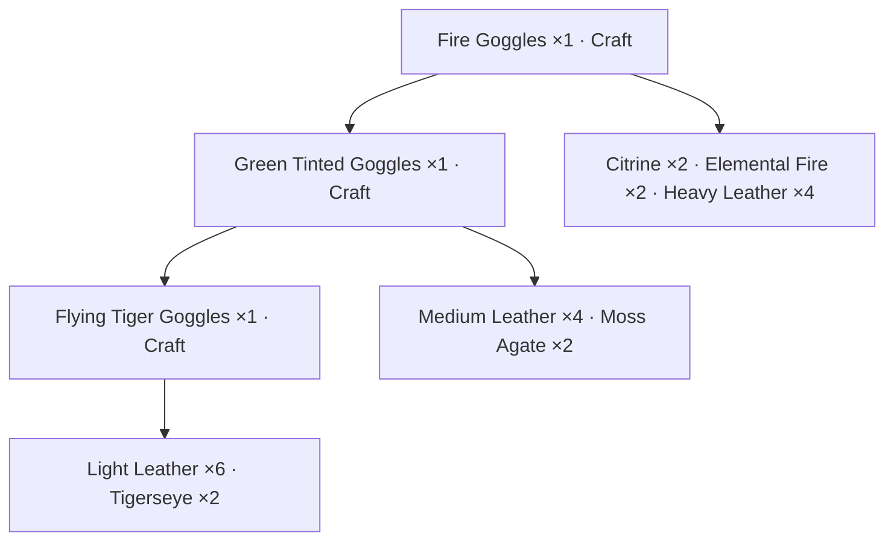

# Engineering dependency tree — design preview

This is a sketch, not an enabled in-game module. Open `engineering-preview.html`
in a browser to try the per-node Craft buttons using simulated inventory.

The example relationships come from matching 3.3.5a Spell/SkillLineAbility DBCs
and AzerothCore item names, not invented recipe ingredients:

In-game layout: an indented tree under the selected recipe, with connecting
lines, native item links/icons, required/carried quantities and one Craft button
per craftable node. Disabled nodes display a concrete missing-material, tool,
skill, cooldown or learned-recipe reason. Raw and other-profession materials
remain visible. Native tooltips preserve third-party bank tooltip additions;
only bag contents enable crafting. One click performs one normal cast and
keeps the selected top-level recipe. Existing progress/window behavior is shared.

Before implementing: choose a learned recipe when multiple methods exist; allow
explicit alternatives; account for shared materials once and craft yield ranges;
expand only shortages by default; stop cycles and bound depth/node count.
Cross-profession steps stay references unless their profession is open and the
recipe can be cast. Never silently switch professions or automate chained casts.

`EngineeringData.lua` and `tools/generate_engineering.py` are source scaffolding,
deliberately absent from the TOC. The manifest records data hashes and core
revision. No live database overrides were queried. The browser demonstration
does not call WoW APIs or claim to show the player's real bags.
